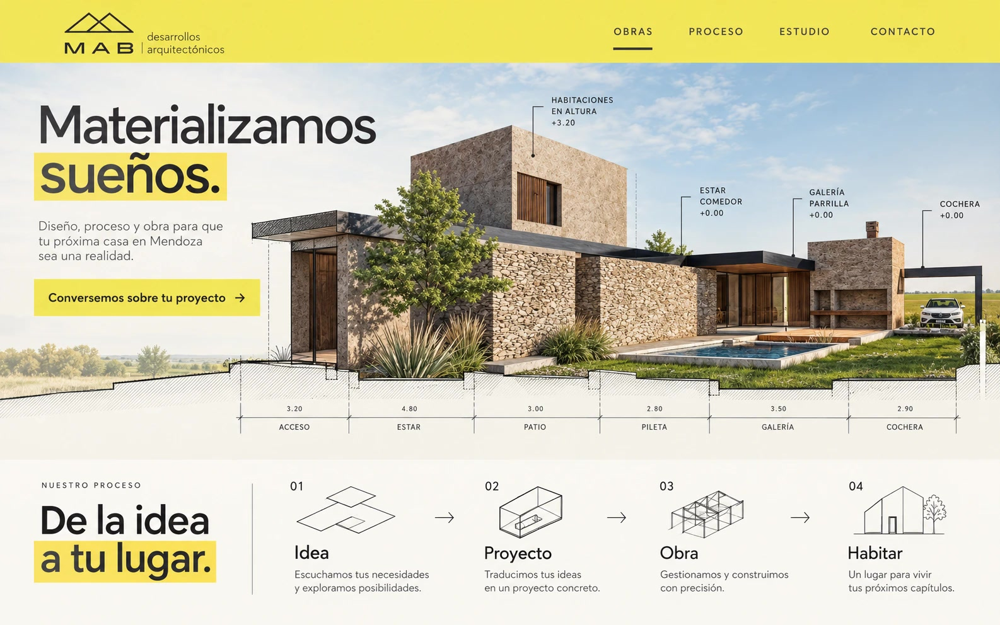
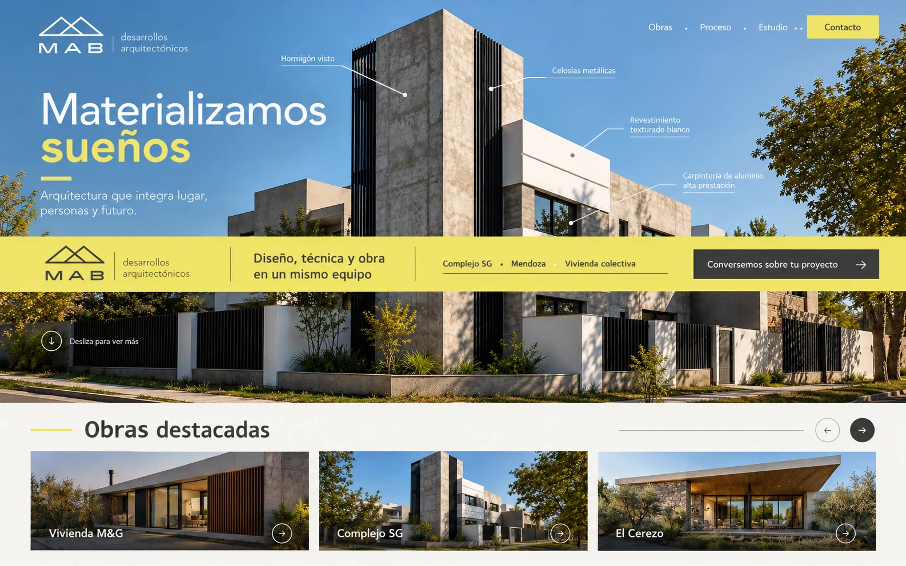
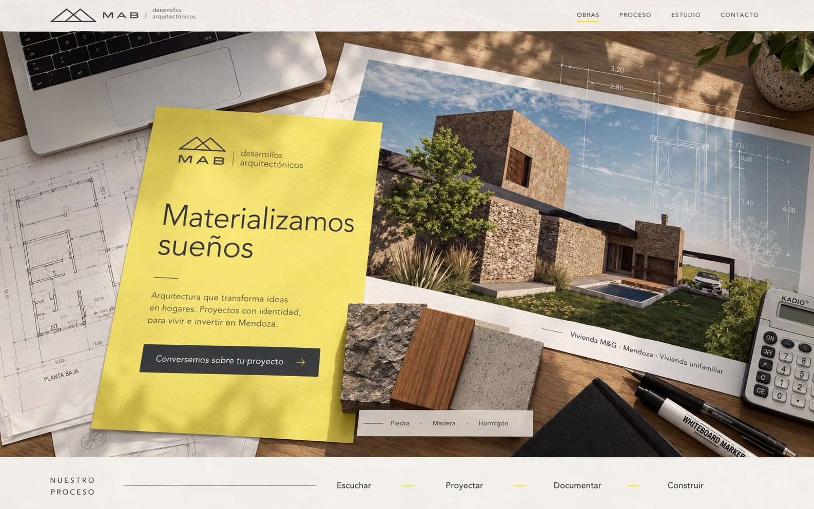

# Handoff — MAB Arquitectos

> Actualización del 21/10/2026: las tres propuestas se corrigieron localmente
> para recuperar sus referencias visuales. Ver `IMPLEMENTACION.md` y `DESIGN.md`
> para el estado actual. Las descripciones visuales de las secciones siguientes
> corresponden a la implementación anterior; consultar esos dos documentos
> para las correcciones. Se mantienen las tres rutas públicas existentes.

Este documento reúne el contexto, las decisiones y el estado técnico del sitio
para continuar el trabajo en otro modelo o en otra sesión sin depender del
historial de conversación.

## 1. Resultado actual

Se construyeron tres propuestas completas y responsive para MAB Arquitectos:

| Propuesta | Concepto | Local | Producción |
|---|---|---|---|
| 1 | Casa desplegada | `http://localhost:8080/` | <https://mab-arquitectos.pages.dev/> |
| 2 | Franja de obra | `http://localhost:8080/2/` | <https://mab-arquitectos.pages.dev/2/> |
| 3 | Mesa de proyecto | `http://localhost:8080/3/` | <https://mab-arquitectos.pages.dev/3/> |

Repositorio público: <https://github.com/Zhinon/mab-arquitectos>

Cloudflare Pages: <https://mab-arquitectos.pages.dev>

El sitio está publicado mediante **Direct Upload con Wrangler**. El proyecto de
Cloudflare se llama `mab-arquitectos`. Actualmente no existe una integración
automática GitHub → Cloudflare: después de cambios hay que volver a ejecutar el
deploy o configurar la integración desde el panel.

## 2. Imágenes de decisión visual

Estas fueron las tres imágenes presentadas para comparar las direcciones:

### Propuesta 1 — Casa desplegada



### Propuesta 2 — Franja de obra



### Propuesta 3 — Mesa de proyecto



Los JPG sirven para aprobación y comparación. Las páginas implementadas usan
HTML, CSS, tipografía y fotografías reales; no son estas imágenes convertidas en
una web.

## 3. Devolución recibida de MAB

La devolución llegó mediante dos audios de WhatsApp:

- La primera propuesta fue la preferida porque se percibe más clara, limpia y
  pura; la imagen y el proyecto arquitectónico conservan el protagonismo.
- Gustó especialmente la distribución de las obras destacadas de la segunda
  propuesta.
- La dirección elegida inicialmente fue: **“creo que vamos por la primera”**.
- El lema correcto es **“Materializando sueños”**, no “Materializamos sueños”.
- Las etiquetas arquitectónicas que aparecían sobre el edificio en una
  composición conceptual eran incorrectas: no deben reproducirse literalmente.
  La fachada mostrada correspondía a dormitorios, vestidor y baño; el frente
  estaba del otro lado.

La opción 1 implementada combina por eso la dirección “Casa desplegada” con la
claridad de presentación de obras de “Franja de obra”. Más tarde se decidió
implementar también las opciones 2 y 3 para que el estudio pueda comparar las
tres páginas completas.

## 4. Información confirmada de la marca

- Nombre: **MAB Arquitectos**.
- Fundadores: **Helga Aranda** y **Enzo Bernal**.
- Lema: **“Materializando sueños”**.
- Helga lidera Diseño y Desarrollo de Proyecto.
- Enzo lidera el área Comercial, Técnica y de Obras.
- Ubicación y mercado principal: Mendoza, Argentina.
- Correo: `aranda.bernal.arq@gmail.com`.
- WhatsApp: `+54 9 261 587-9664`.
- Instagram: <https://www.instagram.com/mab.arquitectos/>.
- Marca visual: símbolo de cubiertas superpuestas, amarillo cálido y gris
  grafito.
- Voz: profesional, clara, humana, concreta y cercana.

No inventar premios, métricas, testimonios, resultados comerciales ni datos de
proyecto no proporcionados por el estudio.

## 5. Fuentes y documentación consultadas

Fuentes compartidas originalmente:

- `/home/zhinon/Descargas/MAB WORD.docx`
- `/home/zhinon/Descargas/Manual Operativo MAB.docx`
- `/home/zhinon/Descargas/PRESUPUESTO MAB WORD(1).docx`
- `/home/zhinon/Descargas/datos mab.png`
- Sitio previo: <https://mab-arquitectos.pattig-mkt.workers.dev/es/>
- Instagram público: <https://www.instagram.com/mab.arquitectos/>

Las fotografías optimizadas recuperadas del sitio público están en
`assets/images/`. El logo horizontal extraído de la documentación está en
`assets/images/mab-lockup.png`.

`PRODUCT.md` contiene el resumen durable de producto, usuarios, posicionamiento,
capacidades, restricciones y principios.

## 6. Dirección visual compartida

Todas las propuestas utilizan:

- Archivo como tipografía de títulos.
- Jost como tipografía de lectura e interfaz.
- Fuentes locales en `assets/fonts/`; no dependen de Google Fonts.
- Amarillo MAB `#f5e653` como color de identidad y acción.
- Grafito como tinta técnica.
- Fotografía real como evidencia principal.
- Lenguaje editorial inspirado en planos, cotas y materialidad, sin convertir la
  página en una plantilla genérica de arquitectura.
- Navegación accesible, foco visible, texto alternativo y respeto por
  `prefers-reduced-motion`.
- Selector fijo `Propuestas 1 · 2 · 3` para facilitar la comparación. Este
  selector debe eliminarse cuando se elija la versión definitiva.

### Propuesta 1 — Casa desplegada

- Archivo principal: `index.html` y `styles.css`.
- Fotografía hero: Vivienda M&G.
- Composición clara de texto a la izquierda y arquitectura dominante a la
  derecha.
- Línea de proyecto/obra/habitar como detalle técnico.
- Sección azul para el proceso.
- Obras destacadas organizadas con la claridad editorial de la propuesta 2.
- Sección de estudio en tono arena y cierre amarillo.

### Propuesta 2 — Franja de obra

- Archivos: `2/index.html`, `2/styles.css`, `2/overrides.css`.
- Fotografía hero: Complejo SG.
- Una franja amarilla vertical funciona como sistema de información: lema,
  posición, llamada a la acción y datos del proyecto.
- Las tres obras se presentan como una franja fotográfica editorial asimétrica.
- Es la opción más directa, gráfica y orientada a portfolio.

### Propuesta 3 — Mesa de proyecto

- Archivos: `3/index.html`, `3/styles.css`, `3/overrides.css`.
- Fotografía hero: Vivienda M&G.
- La interfaz se compone como una mesa de trabajo: plano de fondo, fotografía,
  ficha amarilla, materiales y cotas.
- Es la opción más táctil, conceptual y vinculada al proceso de proyecto.

## 7. Proyectos e imágenes disponibles

Fotografías organizadas en `assets/images/`:

- Vivienda M&G: `mg-patio`, `mg-frente`, `mg-acceso`.
- Complejo SG: `sg-volumen`, `sg-esquina`, `sg-detalle`.
- El Cerezo: `cerezo-arbol`, `cerezo-obra`, `cerezo-proyecto`.
- Candelas: `candelas-dia`, `candelas-noche`, `candelas-escalera`.
- CG: `cg-fachada`, `cg-balcon`, `cg-detalle`.
- Interiores: `int-bano`, `int-dressoire`, `int-homeoffice`.
- Otras: `damajuana`, `mercato-obra`, `trigolino`.
- Mesa de trabajo: `estudio-planos.v1.webp`.

No se recuperaron retratos confirmados de Helga y Enzo. Mientras no existan,
evitar presentar fotografías de terceros como si fueran los arquitectos.

## 8. Arquitectura técnica

- HTML, CSS y JavaScript estáticos.
- Sin framework y sin dependencias de ejecución.
- `scripts.js` controla el menú móvil y el año del footer para las tres rutas.
- `package.json` fija la raíz del proyecto para Wrangler y ofrece el comando:

  ```bash
  npm run dev
  ```

- Alternativamente:

  ```bash
  python3 -m http.server 8080
  ```

- Rutas estáticas:
  - `/` → opción 1
  - `/2/` → opción 2
  - `/3/` → opción 3

## 9. GitHub y cuentas

Hay dos identidades de GitHub configuradas en el equipo:

- `Zhinon`: cuenta personal y propietaria de este repositorio.
- `naranda-ms`: cuenta laboral, conservada pero inactiva en `gh` al momento de
  publicar.

GitHub CLI admite ambas. Se alternan con:

```bash
gh auth switch --hostname github.com --user Zhinon
gh auth switch --hostname github.com --user naranda-ms
```

Antes de crear repositorios o hacer operaciones administrativas, verificar:

```bash
gh auth status
```

No guardar ni documentar tokens, contraseñas o códigos OAuth.

## 10. Cloudflare y despliegue

Cuenta autorizada en Wrangler: `aranda.ariel.norberto@gmail.com`.

El despliegue actual se hizo desde un directorio temporal compuesto solamente
por archivos versionados, para no cargar archivos de trabajo ignorados:

```bash
MAB_DEPLOY_DIR=$(mktemp -d /tmp/mab-pages-XXXXXX)
git archive HEAD | tar -x -C "$MAB_DEPLOY_DIR"
WRANGLER_CACHE_DIR=/tmp/mab-wrangler-cache \
WRANGLER_LOG_PATH=/tmp/mab-wrangler-deploy.log \
npx wrangler pages deploy "$MAB_DEPLOY_DIR" \
  --project-name=mab-arquitectos \
  --branch=main
```

La variable `WRANGLER_CACHE_DIR` evita que Wrangler intente escribir la caché en
una ubicación de solo lectura del entorno de Codex. `package.json` evita que
Wrangler detecte por error un proyecto superior en `/home/zhinon`.

## 11. Próximas decisiones recomendadas

1. Conseguir una aprobación definitiva entre las tres opciones.
2. Mantener solo la opción elegida en `/` y retirar `/2/`, `/3/` y el selector.
3. Revisar con MAB nombres, tipologías y textos de cada obra.
4. Sustituir o ampliar las fotografías con material original de máxima calidad.
5. Definir el mecanismo de contacto:
   - WhatsApp y `mailto:` ya funcionan.
   - Para un formulario real en Cloudflare gratuito se puede usar Formspree o un
     Worker/Pages Function que envíe mediante un proveedor de correo.
6. Agregar favicon, Open Graph definitivo y metadatos sociales.
7. Comprar y conectar `mabarquitectos.com` cuando el estudio apruebe la web.
8. Configurar GitHub → Cloudflare si se desean deploys automáticos con cada push.
9. Hacer una revisión final de accesibilidad, rendimiento y contenido antes de
   anunciar el dominio.

## 12. Criterios para continuar sin degradar el trabajo

- No convertir las propuestas en una landing genérica de tarjetas repetidas.
- No reemplazar la fotografía real por imágenes generadas sin aprobación.
- No usar etiquetas técnicas decorativas que afirmen algo incorrecto del
  proyecto.
- Mantener la arquitectura como protagonista y el amarillo como sistema, no
  como adorno disperso.
- Mantener el lema exactamente como **“Materializando sueños”**.
- Verificar cualquier cambio en escritorio y móvil antes de desplegar.

